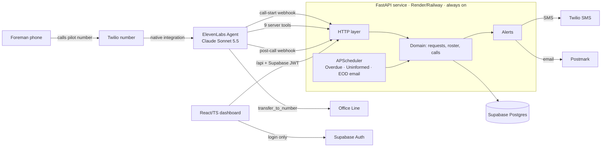

# Architecture — Field Request Assistant (Pilot v1)

Status: Draft · Date: 2026-11-01
Implements: [product-specification.md](product-specification.md) · Vocabulary: [GLOSSARY.md](../GLOSSARY.md) · Decisions: [adr/](adr/) · Build order: [task-dependencies.md](task-dependencies.md)

---

## 1. Overview



| Component | Choice | Notes |
|---|---|---|
| Telephony | Twilio number, imported into ElevenLabs (native) | [ADR 0003](adr/0003-elevenlabs-native-telephony.md) |
| Conversation | ElevenLabs Agents, Claude Sonnet 5.5 (Haiku 4.5 fallback if latency poor) | Agent config versioned in `backend/agent/` |
| Backend | Python 3.12, FastAPI, SQLAlchemy 2, Alembic, Pydantic v2 | Modular monolith, single process |
| Jobs | APScheduler in-process, 1-min tick | No Redis/Celery |
| Database | Supabase Postgres | Accessed only by backend |
| Auth | Supabase Auth (dashboard staff) | Backend verifies JWT; [ADR 0005](adr/0005-dashboard-reads-through-api.md) |
| Dashboard | React + TypeScript (Vite), TanStack Query polling 10 s | Static build served by backend at `/`; API at `/api` |
| SMS | Twilio Messaging | Same account as voice |
| Email | Postmark | Already in use |
| Hosting | Render or Railway, always-on instance | No cold starts (call-start webhook is on the critical path) |
| Errors / uptime | Sentry; external uptime monitor on `/healthz` | |

## 2. Repository layout

```
voice-agent/
├── AGENTS.md        instructions for coding agents
├── README.md
├── PROGRESS.md      task status log (T01–T19)
├── GLOSSARY.md
├── docs/            product-specification, architecture, task-dependencies, adr/
├── backend/
│   ├── pyproject.toml
│   ├── app/                 FastAPI package
│   │   ├── main.py
│   │   ├── config.py            settings per env
│   │   ├── db/                  models, session, migrations/ (Alembic)
│   │   ├── domain/              pure rules — no I/O
│   │   │   ├── lifecycle.py     transitions + guards
│   │   │   ├── sla.py           ack windows, Overdue, Uninformed
│   │   │   ├── dedupe.py        duplicate matching
│   │   │   ├── jobs_match.py    fuzzy job/alias matching
│   │   │   └── timeparse.py     "tomorrow at seven" → datetime
│   │   ├── services/            use cases: requests, calls, roster, alerts
│   │   ├── integrations/        elevenlabs.py, twilio_sms.py, postmark.py
│   │   ├── http/                hooks.py (EL webhooks), tools.py (EL tools), api.py (dashboard)
│   │   └── jobs.py              scheduler
│   └── agent/               ElevenLabs agent as code
│       ├── prompt.md
│       ├── agent.json           voice, LLM, first message, system tools
│       ├── tools/*.json         server tool schemas
│       ├── tests/*.json         EL simulation tests (one+ per AC)
│       └── push.py              sync config + tests to an env's agent
├── frontend/        React/TS dashboard (Vite); Vitest specs co-located
└── tests/           backend unit/, integration/, fixtures/ (recorded EL payloads), e2e/ (Playwright), AC_MATRIX.md
```

Layering rule: `http` → `services` → `domain` + `db` + `integrations`. `domain` imports nothing from the others.

## 3. Call flows

### 3.1 Call start (every call)

```mermaid
sequenceDiagram
  participant T as Twilio
  participant E as ElevenLabs
  participant B as Backend
  T->>E: inbound call (caller_id)
  E->>B: POST /hooks/call-start {caller_id, called_number, call_sid, conversation_id}
  B->>B: lookup foreman_phones; insert calls row
  alt rostered
    B-->>E: dynamic_variables {foreman_first_name, jobs, open_requests, now_local}
  else unrostered
    B-->>E: dynamic_variables {rejected:true} + override first_message = rejection line
    E->>E: say line, end_call
  end
```

- Must respond fast (target p95 < 500 ms). Single indexed lookup + small query.
- `calls` row keyed by `conversation_id` binds the conversation to the verified foreman; every later tool call resolves identity from it ([ADR 0004](adr/0004-backend-owns-request-rules.md)).

### 3.2 During the call — tools

The agent passes `conversation_id` (from `system__conversation_id`) as a header; never a foreman ID.

### 3.3 Transfer / Emergency

1. Agent calls `transfer_to_office` (or `start_emergency`) server tool → backend writes alerts (dashboard pop-up row + SMS to on-duty coordinator; emergency: SMS to all coordinators, Emergency request created) and returns `{ok:true}`.
2. Agent says "Connecting you to the office now." and invokes ElevenLabs system tool `transfer_to_number` (conference) to the office line.
3. Outcome of the transfer is not observable ([ADR 0003](adr/0003-elevenlabs-native-telephony.md)).

### 3.4 Post-call

`POST /hooks/post-call` (`post_call_transcription`):
1. Verify `ElevenLabs-Signature` HMAC; reject unsigned.
2. Idempotent on `conversation_id` (upsert).
3. Store transcript, summary, duration, termination reason on `calls`; set `calls.outcome`.
4. If no request was submitted on this call **and** EL data-collection found a need → create Draft request(s) with extracted fields, linked via `call_requests`.

Audio stays in ElevenLabs (retention set to 90 days); the dashboard streams it via `GET /api/calls/{id}/audio`, which proxies the EL API.

## 4. Interfaces

### 4.1 ElevenLabs → backend webhooks

| Endpoint | Auth | Purpose |
|---|---|---|
| `POST /hooks/call-start` | secret header `X-Hook-Secret` | Roster check, context injection |
| `POST /hooks/post-call` | `ElevenLabs-Signature` HMAC | Transcript, Drafts |

### 4.2 Agent tools (`POST /tools/*`, header `X-Tool-Secret` + `X-Conversation-Id`)

| Tool | Input | Output | Rules enforced in backend |
|---|---|---|---|
| `find_jobs` | `query` | up to 3 `{job_id, name, score}` | Active jobs only; score threshold → empty = Unmatched |
| `resolve_needed_by` | `needed_by_spoken` | `{needed_by_resolved, urgency}` | Time parsing for the read-back before submit (added by #14); writes nothing |
| `find_open_requests` | `job_id?`, `category?` | `[{ref, job, category, need, quantity, unit, needed_by, status, owner, outcome, explanation}]` | Caller's own requests only |
| `submit_requests` | `items[]: {job_id?, job_spoken, category, need, quantity?, unit?, needed_by_spoken?, urgency_hint?}` | `[{ref, needed_by_resolved, urgency}]` | Time parsing, urgency, default owner, Today SMS alert, Recorded status |
| `amend_request` | `ref`, `changes` | `{applied: bool, status}` | Applies only before In Progress; else note + Change requested flag |
| `withdraw_request` | `ref` | `{applied: bool}` | Before In Progress → Resolved/Withdrawn; else flag |
| `add_note` | `ref`, `text`, `urgent?` | `{ok}` | Alerts coordinator when urgent |
| `create_callback_request` | `reason?` | `{ref}` | Callback category, Today urgency, SMS on-duty + backup |
| `transfer_to_office` | `reason?` | `{ok}` | Pop-up + SMS to on-duty coordinator |
| `start_emergency` | `summary` | `{ref}` | Emergency request, SMS all coordinators, pop-up |

Plus ElevenLabs system tools: `transfer_to_number` (office line, conference), `end_call`.

Tool contract: tools return short, speakable facts; errors return `{error: "<speakable reason>"}` with HTTP 200 so the agent can say "I couldn't save that" (spec §8). Timeout target < 2 s.

### 4.3 Dashboard API (`/api/*`, `Authorization: Bearer <Supabase JWT>`)

| Method & path | Role | Purpose |
|---|---|---|
| `GET /api/requests?status&flag&job&q` | coordinator | Queue (sorted urgency, age) + counts |
| `GET /api/requests/{ref}` | coordinator | Detail, events, notes, linked calls |
| `POST /api/requests` | coordinator | Quick-entry (J7) |
| `GET /api/quick-entry` | coordinator | Quick-entry choices: active Foremen and Jobs, Categories, Owners |
| `PATCH /api/requests/{ref}` | coordinator | Edit fields / fix job |
| `POST /api/requests/{ref}/acknowledge` | coordinator | Requires `owner_id` |
| `POST /api/requests/{ref}/start` | coordinator | → In Progress |
| `POST /api/requests/{ref}/resolve` | coordinator | Requires `outcome` + `explanation` |
| `POST /api/requests/{ref}/informed` | coordinator | Foreman Informed |
| `POST /api/requests/{ref}/notes` | coordinator | Add note |
| `POST /api/requests/{ref}/merge` | coordinator | Merge into another ref |
| `GET /api/popups?since` | coordinator | Incoming transfer / emergency pop-ups |
| `GET /api/calls/{id}`, `/audio` | coordinator | Transcript, audio proxy |
| `CRUD /api/admin/{foremen,jobs,owners,staff,duty,settings}` | admin | Roster and config |

All writes go through `services/`, which writes the domain change and a `request_events` row in one transaction.

## 5. Data model

All timestamps `timestamptz` (UTC); displayed and parsed in `America/New_York`.

| Table | Key columns |
|---|---|
| `foremen` | id, first_name, last_name, active |
| `foreman_phones` | id, foreman_id, e164 (unique) |
| `jobs` | id, name, active |
| `job_aliases` | id, job_id, alias |
| `owners` | id, name, phone_e164?, email? |
| `category_owner_defaults` | category (pk), owner_id |
| `staff` | id = Supabase auth user id, name, phone_e164, email, role (`coordinator` \| `admin`) |
| `duty_roster` | date (pk), on_duty_staff_id, backup_staff_id |
| `settings` | singleton: office_line_e164, ack_window_today_min (15), ack_window_planned_min (120), uninformed_after_min (120), timezone |
| `requests` | id, ref (seq from 1000, rendered R-1042), foreman_id, job_id?, job_spoken, category, need, quantity?, unit?, needed_by?, needed_by_spoken?, urgency, status, owner_id?, outcome?, explanation?, foreman_informed_at?, source (`ai_call` \| `coordinator`), flags (unverified fields, change_requested), merged_into_id?, recorded_at, acknowledged_at, ack_due_at, resolved_at |
| `request_events` | id, request_id, at, actor_type (`agent` \| `staff` \| `system`), actor_id?, kind, before jsonb, after jsonb |
| `request_notes` | id, request_id, at, author_type, author_id?, text, urgent |
| `calls` | id, conversation_id (unique), call_sid, caller_e164, foreman_id?, started_at, ended_at, duration_s, termination_reason, transcript jsonb, summary, outcome (`submitted` \| `draft` \| `transferred` \| `emergency` \| `rejected` \| `status_only` \| `none`) |
| `call_requests` | call_id, request_id, relation (`created` \| `looked_up` \| `amended`) |
| `alerts` | id, request_id?, call_id?, kind (`today_new` \| `callback` \| `emergency` \| `overdue` \| `transfer` \| `eod_summary`), channel (`sms` \| `email` \| `popup`), to_staff_id?, sent_at (attempted), provider_id?, status (`pending` \| `sent` \| `failed`), detail? (why not sent), seen_at? |

Derived, not stored: **Overdue** = status Recorded and `now > ack_due_at`; **Uninformed** = Resolved, `foreman_informed_at` null, and `now > resolved_at + uninformed_after`.

Lifecycle guards (`domain/lifecycle.py`): Draft→Recorded; Recorded→Acknowledged (owner required); Acknowledged→In Progress; any non-Resolved→Resolved (outcome + explanation required); agent may only Recorded/Acknowledged→Resolved(Withdrawn). No hard delete.

## 6. Scheduled jobs (`backend/app/jobs.py`)

| Job | Cadence | Action |
|---|---|---|
| Overdue sweep | 1 min | Newly Overdue → SMS backup coordinator (once per request) |
| Uninformed sweep | 5 min | Flag only (dashboard) |
| End-of-day summary | 17:00 local | Postmark email: new Planned requests, open counts |
| Webhook health | daily | Check EL post-call webhook still enabled; Sentry alert if not |

Jobs are idempotent (alerts table records what was sent) so a restart can't double-send.

## 7. Security

- Secrets (EL tool/hook secret, Twilio, Postmark, Supabase service key) in host env vars; EL-side secrets in the EL secret store.
- Post-call HMAC verified; tool and call-start endpoints require secret header and reject unknown `conversation_id`.
- Supabase service key used only by backend; browser gets only anon key for login.
- Recordings accessible to coordinators/admin only, through the backend proxy.
- No PII in URLs or logs beyond conversation_id and ref.

## 8. Environments

| Env | Twilio number | EL agent | DB | Purpose |
|---|---|---|---|---|
| local | none (EL tests with mocked tools; ngrok for live) | dev agent | Supabase local (Docker) | Development |
| staging | staging number | staging agent | Supabase staging project | Scripted calls, EL tests, AC verification |
| prod | pilot number | prod agent | Supabase prod project | Pilot |

`backend/agent/push.py --env <env>` makes the EL agent match the repo (prompt, tools, tool URLs per env, tests).

## 9. Testing strategy

| Layer | Tooling | Covers | Runs |
|---|---|---|---|
| 1. Domain unit | pytest | lifecycle guards, SLA/Overdue/Uninformed math, dedupe, job matching, time parsing | every PR |
| 2. API integration | pytest + httpx + Supabase local Postgres | every tool + webhook with recorded EL payloads; dashboard API guards (AC9.x); audit rows | every PR |
| 3. Agent behavior | ElevenLabs simulation tests (mocked tools, injected dynamic vars) | spec ACs for J1–J8 conversation behavior; ACX.1/ACX.2 | merge to main, against staging agent |
| 4. Dashboard | Vitest + Playwright | ack requires owner, resolve requires outcome, pop-up shows | every PR (Vitest), main (Playwright) |
| 5. Live call scripts | Manual checklist, real phones | transfer, emergency, noise, poor connection, unrostered, SMS timing | before launch; after telephony/agent changes |

Every spec AC is mapped to at least one layer in `tests/AC_MATRIX.md`.

## 10. CI/CD and observability

- GitHub Actions. PR: ruff, mypy, tsc, layers 1, 2, 4 (Vitest). Main: deploy staging, `push.py --env staging`, layer 3, Playwright. Prod: manual deploy from tag, then `push.py --env prod`.
- Sentry (backend + web). Structured JSON logs with `conversation_id` and `ref`. Uptime monitor on `/healthz` → SMS within 1 min.

## 11. Known risks

| Risk | Mitigation |
|---|---|
| Unanswered transfer invisible | Pre-transfer pop-up + SMS; revisit ADR 0003 if seen in pilot |
| Call-start webhook down → call dropped | Always-on instance, uptime alert |
| Post-call webhook auto-disabled by EL | Daily health check |
| LLM latency on Sonnet 5.5 | Measure in staging; fall back to Haiku 4.5 |
| Time/date misinterpretation | Backend parses; agent reads back resolved time |
