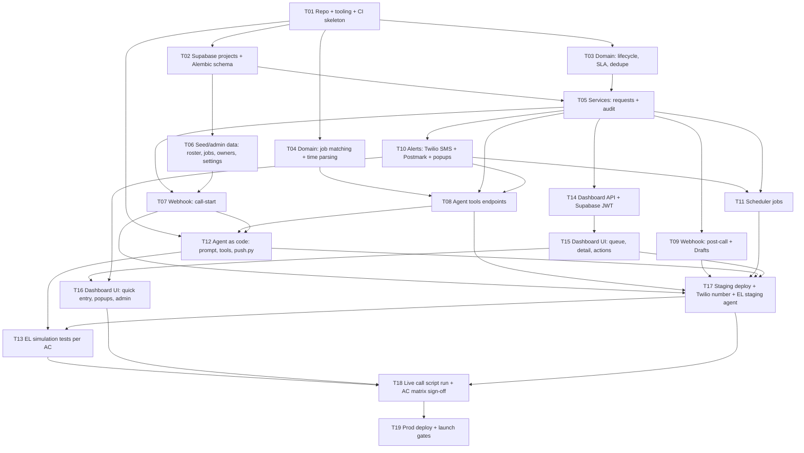

# Build Tasks & Dependencies — Pilot v1

Implements [architecture.md](architecture.md). Target: working staging system by pilot day 12, first foreman day 13.

## Dependency graph

## Tasks

| ID | Task | Depends on | Done when | Est. |
|---|---|---|---|---|
| T01 | Scaffold `backend/` (pyproject, `app/`, `agent/`), `frontend/`, `tests/`, uv/ruff/mypy, Vite+TS, GitHub Actions PR workflow, `/healthz` | — | CI green on empty app; `/healthz` 200 | 0.5 d |
| T02 | Supabase local + staging + prod projects; SQLAlchemy models + Alembic migration for all tables in architecture §5; ref sequence from 1000 | T01 | `alembic upgrade head` on local and staging | 1 d |
| T03 | `domain/lifecycle.py`, `sla.py`, `dedupe.py` + unit tests | T01 | Guards reject ack-without-owner, resolve-without-outcome, agent amend after In Progress; Overdue/Uninformed math tested | 1 d |
| T04 | `domain/jobs_match.py` (rapidfuzz on names + aliases, threshold), `timeparse.py` ("tomorrow at seven", "first thing", "this afternoon" → America/New_York) + unit tests | T01 | Table-driven tests incl. "R-104 vs Route 104", late-night "tomorrow morning" | 1 d |
| T05 | `services/requests.py`: create, amend, withdraw, note, ack, start, resolve, informed, merge — each writes `request_events` in same transaction | T02, T03 | Integration tests: every write produces audit row; no delete path | 1 d |
| T06 | Seed script + minimal admin endpoints for foremen/phones, jobs/aliases, owners, category defaults, staff, duty roster, settings | T02 | Staging seeded with pilot roster and jobs | 0.5 d |
| T07 | `POST /hooks/call-start`: secret check, roster lookup, `calls` insert, dynamic vars (name, jobs, open requests, now_local) or rejection override | T05, T06 | Integration test with recorded payload; p95 < 500 ms locally | 0.5 d |
| T08 | `/tools/*` (9 tools, architecture §4.2): conversation→foreman resolution, speakable responses/errors | T04, T05, T10 | Integration tests per tool incl. dedupe, In-Progress protection, callback/emergency alerts | 1.5 d |
| T09 | `POST /hooks/post-call`: HMAC verify, idempotent upsert, transcript/summary, Draft creation from EL data collection | T05 | Tests: bad signature rejected, replay is no-op, hang-up payload → Draft | 0.5 d |
| T10 | `integrations/twilio_sms.py`, `postmark.py`; `services/alerts.py` with `alerts` table idempotency; popup rows | T05 | SMS + email delivered from staging; alert recorded once | 0.5 d |
| T11 | APScheduler: Overdue sweep → backup SMS, Uninformed flag, 17:00 EOD email, daily webhook-health check | T05, T10 | Time-frozen tests; restart doesn't double-send | 0.5 d |
| T12 | `backend/agent/`: prompt (behavior rules from spec §7, lifecycle wording, read-back, one question at a time, transfer/emergency lines), `agent.json` (Sonnet 5.5, voice, data-collection fields, retention 90 d), tool schemas, `push.py --env` | T07, T08 (contracts) | `push.py --env staging` makes EL agent match repo | 1 d |
| T13 | EL simulation tests for J1–J8 + ACX.1/ACX.2; `tests/AC_MATRIX.md` mapping every AC to a layer | T12, T17 | All AC-mapped simulation tests pass on staging agent | 1 d |
| T14 | `/api/*` dashboard endpoints (architecture §4.3), Supabase JWT verification, role checks, audio proxy | T05 | Integration tests for AC9.1–AC9.5 at API level | 1 d |
| T15 | React: login (Supabase), queue with counts + flags + 10 s polling, request detail (events, notes, transcript, audio), ack/start/resolve/informed/merge | T14 | Playwright: ack needs owner, resolve needs outcome | 1.5 d |
| T16 | React: quick-entry form (< 30 s), incoming transfer/emergency pop-ups, admin screens | T15, T10 | Pop-up appears within one poll of `transfer_to_office` | 1 d |
| T17 | Render/Railway staging (always-on), Sentry, uptime monitor, staging Twilio number imported into EL, EL webhooks + secrets configured; main-branch deploy workflow | T07, T08, T09, T11, T12, T15 | Real call to staging number reaches agent and creates a request visible in dashboard | 0.5 d |
| T18 | Run live call scripts (transfer to office line, emergency, noise, bad signal, unrostered, multi-need, SMS timing); fix; sign off AC matrix | T13, T16, T17 | Every AC passes or has an accepted exception | 1 d |
| T19 | Prod: pilot number, prod agent, prod Supabase, tag deploy; confirm launch gates in spec §11 | T18 | Launch gates checked; first foreman onboarded | 0.5 d |

Total ≈ 16 dev-days single-threaded; critical path ≈ 9 days.

## Critical path

T01 → T02 → T05 → T10 → T08 → T12 → T17 → T13 → T18 → T19

## Parallel tracks (after T05)

- **Voice track:** T07, T08, T09 → T12 → T13
- **Office track:** T14 → T15 → T16
- **Ops track:** T10, T11, T17

## Non-dev prerequisites (owner: you / Schreiber, needed by T17–T19)

| Item | Needed by |
|---|---|
| Twilio account + 2 numbers (staging, pilot) | T17 |
| ElevenLabs workspace (plan tier, retention set to 90 d) | T12 |
| Supabase org (3 projects) | T02 |
| Postmark server + sender signature | T10 |
| Office line number; who answers overnight transfers | T17 / T18 |
| Pilot roster: foremen names + phones; job list + aliases; owners per category | T06 |
| Staff list (coordinators, admin) + duty roster | T06 |
| Safety-lead-approved emergency line | T12 / T19 |
| Recording consent + retention policy review | T19 |
